# Cloudflare OS Starter Deployment Guide

A complete guide to deploying your customized Cloudflare OS instance using this starter repository.

## Prerequisites

Before starting, ensure you have:

1. **Node.js 24.19 or newer**
   ```bash
   node --version
   ```

2. **pnpm 11.17**
   ```bash
   npm install -g pnpm
   pnpm --version
   ```

3. **Cloudflare Account**
   - Active Cloudflare account with Workers, KV, R2, and Browser Rendering enabled
   - Find your [Account ID](https://developers.cloudflare.com/fundamentals/account/find-account-and-zone-ids/)

4. **Cloudflare Access Setup** (for production)
   - Cloudflare One subscription
   - Active Cloudflare zone (for custom domain)
   - Configured self-hosted Access application

## Step 1: Initial Setup

### 1.1 Clone and initialize the repository

```bash
git clone https://github.com/sjoerd2025/cloudflare-os-starter.git
cd cloudflare-os-starter

# Initialize the submodule
git submodule update --init

# Install dependencies
pnpm install
pnpm --dir cloudflare-os install

# Authenticate with Cloudflare
pnpm exec wrangler login
```

### 1.2 Verify installation

```bash
node --version      # Should be 24.19+
pnpm --version      # Should be 11.17+
pnpm exec wrangler whoami
```

## Step 2: Configure deployment.jsonc

Edit `deployment.jsonc` with your deployment settings:

### 2.1 Account and Base Configuration

```jsonc
{
  // Your Cloudflare account ID (32 hex characters)
  "accountId": "<YOUR_ACCOUNT_ID>",
  
  // Leave null to derive from router's custom domain
  // On workers.dev: https://<router-name>.<subdomain>.workers.dev
  "publicBaseUrl": null,
  
  "workers": {
    "router": {
      "name": "my-os-router",
      // Production: use a hostname in your Cloudflare zone
      "route": { "customDomain": "os.example.com" }
      // Evaluation: "route": { "workersDev": true }
    },
    "workshop": { "name": "my-os-workshop" },
    "context": { "name": "my-os-context" },
    "scheduler": { "name": "my-os-scheduler" },
    "customGatekeeper": { "name": "my-os-custom" },
    "errorReporter": { "name": "my-os-error-reporter" }
  }
}
```

### 2.2 Cloudflare Access Configuration

First, create a [self-hosted Access application](https://developers.cloudflare.com/cloudflare-one/access-controls/applications/http-apps/self-hosted-public-app/):

1. Go to **Cloudflare Dashboard** → **Cloudflare One**
2. Navigate to **Access** → **Applications**
3. Click **Add an application** → **Self-hosted**
4. Configure:
   - **Application name**: Your deployment name
   - **Subdomain**: Any available subdomain for your team domain
   - **Domain**: Leave the default (usually `cloudflareaccess.com`)
   - **Application URL**: Your custom domain (e.g., `https://os.example.com`)
5. Save and note the **AUD (Audience) tag** from the **Authorization** tab

Then update `deployment.jsonc`:

```jsonc
{
  "access": {
    "issuer": "https://<YOUR_TEAM_NAME>.cloudflareaccess.com",
    "audience": "<YOUR_AUD_TAG>",
    "admins": ["admin@example.com", "admin2@example.com"]
  }
}
```

### 2.3 AI Gateway Configuration

```jsonc
{
  "aiGateway": {
    "enabled": true,
    "name": "default",  // or your custom gateway name
    "accountId": null,  // null = same account as deployment
    "providers": ["cloudflare", "anthropic", "openai"]  // or just ["cloudflare"]
  }
}
```

**Note**: Providers like `cloudflare`, `anthropic`, and `openai` reach AI Gateway over the pre-authenticated `WORKERS_AI` binding and require no token when using the deployment's own account (configure BYOK keys in your Cloudflare dashboard). Only the `google` provider or a gateway in a different account requires `CF_AI_GATEWAY_API_TOKEN` (see Step 3.1).

### 2.4 Custom Gatekeeper Display

```jsonc
{
  "customGatekeeper": {
    "name": "Your Organization Name",
    "message": "Integration with Your Organization for deployment information"
  }
}
```

### 2.5 Context and Storage Configuration

```jsonc
{
  "context": {
    "sharingDomain": null,  // null = scope to public origin
    "kvNamespaceId": null,  // null = auto-provision with Wrangler
    // Optional: Git-compatible collection storage (requires Artifacts account access)
    "artifacts": {
      "enabled": false,
      "namespace": "gatekeeper-context-collections" // optional; defaults to this namespace
    }
  },
  
  "resources": {
    "blueprintsKvNamespaceId": null,
    "avatarsKvNamespaceId": null,
    "blueprintContentBucket": null
  }
}
```

### 2.6 Error Reporting Configuration

```jsonc
{
  "errorReporting": {
    "enabled": true,
    "environment": "production",
    "release": null  // Set to commit/version hash when available
  }
}
```

### 2.7 Observability Configuration

```jsonc
{
  "observability": {
    "enabled": true,
    "headSamplingRate": 1,  // 0-1, 1 = 100% sampling
    "logs": {
      "invocationLogs": false
    },
    "traces": {
      "enabled": false,
      "headSamplingRate": 0.1
    }
  }
}
```

## Step 3: Configure Secrets and APIs

### 3.1 AI Gateway API Token (only if required)

Only needed if using the `google` provider or a gateway in a different account (`aiGateway.accountId` set):

```bash
# Create a narrowly-scoped API token: https://dash.cloudflare.com/profile/api-tokens
# Permissions: AI Gateway (Read) or (Run + Read) for custom providers

CLOUDFLARE_ACCOUNT_ID=<YOUR_ACCOUNT_ID> \
pnpm exec wrangler secret put CF_AI_GATEWAY_API_TOKEN \
  --name <YOUR_WORKSHOP_WORKER_NAME>
```

### 3.2 Additional Secrets (if applicable)

For custom Gatekeepers with external APIs:

```bash
# Example: custom service credentials
CLOUDFLARE_ACCOUNT_ID=<YOUR_ACCOUNT_ID> \
pnpm exec wrangler secret put CUSTOM_API_KEY \
  --name <WORKER_NAME>
```

## Step 4: Validate Configuration

Run the validation script to catch configuration issues before deploying:

```bash
pnpm check
```

This will:
- Parse and validate `deployment.jsonc`
- Check Worker names are unique and properly formatted
- Verify Access configuration
- Validate AI Gateway setup and token requirements
- Run test suite
- Build all Workers (dry-run)

### Common Validation Errors

| Error | Solution |
| --- | --- |
| `Missing required deployment value` | Fill in the placeholder value in `deployment.jsonc` |
| `Worker names must be unique` | Change duplicate Worker names to be unique |
| `publicBaseUrl does not match customDomain` | Set `publicBaseUrl` to `null` or matching value |
| `CF_AI_GATEWAY_API_TOKEN is required` | Run the secret installation command above |

## Step 5: Deploy

Once validation passes, deploy all Workers:

```bash
pnpm deploy
```

The deploy script will:

1. Generate production Wrangler configs for each Worker
2. Build all packages and Workers
3. Deploy in order:
   - Error Reporter (if enabled)
   - Context Gatekeeper
   - Scheduler Gatekeeper
   - Custom Gatekeeper
   - Workshop backend
   - Router (last—binds everything)

### Deployment Output

Successful deployment shows:
```
✓ Uploaded router (x.xx KB)
✓ Uploaded workshop (x.xx KB)
✓ Uploaded context (x.xx KB)
✓ Uploaded scheduler (x.xx KB)
✓ Uploaded custom-gatekeeper (x.xx KB)
✓ Uploaded error-reporter (x.xx KB)
```

## Step 6: Verify Deployment

### 6.1 Check Access and Sign-In

```bash
# Open your router hostname
open https://os.example.com

# Expected: Cloudflare Access login, then the Cloudflare OS interface
```

### 6.2 Verify Admin Access

1. Go to `/admin` (e.g., `https://os.example.com/admin`)
2. Confirm your email appears as authorized
3. Test changing branding (site name, logo, color)
4. Note: Branding changes apply immediately, no deploy needed

### 6.3 Test Core Features

```bash
# 1. Router hostname resolves
dig os.example.com

# 2. Check Worker logs
pnpm exec wrangler tail --name my-os-router

# 3. Test backend connectivity
# Go to /admin → Custom Gatekeeper → Enable
# Ask the agent for deployment information

# 4. Verify Storage
# KV namespaces should exist in Cloudflare dashboard
# R2 bucket should exist for blueprint content
```

### 6.4 Inspect Error Reporter (if enabled)

```bash
# View structured error logs
pnpm exec wrangler logs --name my-os-error-reporter
```

## Step 7: Post-Deployment Configuration

### 7.1 Customize Branding (No Deploy Required)

1. Navigate to `/admin`
2. Go to the **General** tab
3. Update:
   - **Site Name**: Display name for your deployment
   - **Logo**: Upload PNG, JPEG, WebP, or SVG (max 5 MB)
   - **Accent Color**: Hex color for UI elements
4. Changes apply immediately

### 7.2 Configure Context Artifacts (Optional)

If you enabled Artifacts in `deployment.jsonc`:

```jsonc
"context": {
  "artifacts": { "enabled": true }
}
```

1. Go to `/admin` → **Context**
2. Create a Git-backed Context collection
3. Provide repository URL and branch
4. Collections auto-refresh on schedule

### 7.3 Enable Scheduled Work (Scheduler)

1. Go to `/admin` → **Scheduler**
2. Set availability (available / optional / disabled)
3. Agents can now schedule work to run in the future

### 7.4 Custom Gatekeeper Integration

1. Go to `/admin` → **Custom Gatekeeper**
2. Enable/disable the custom integration
3. Test by asking agents to read deployment information

## Troubleshooting

### Issue: `git submodule update --init` fails

**Solution**: Ensure you have git installed and internet access. Try:
```bash
git submodule sync
git submodule update --init --recursive
```

### Issue: `pnpm install` times out or fails

**Solution**: Try clearing cache and reinstalling:
```bash
rm -rf node_modules .pnpm-store pnpm-lock.yaml
pnpm install
```

### Issue: Validation fails with missing placeholders

**Solution**: Check `deployment.jsonc` for any `<...>` placeholders and replace with actual values:
```bash
grep -n '<' deployment.jsonc
```

### Issue: Deploy fails with "Worker name already exists"

**Solution**: Change the Worker names in `deployment.jsonc` to be unique within your account:
```jsonc
"workers": {
  "router": { "name": "my-unique-os-router-v2" }
  // ... etc
}
```

### Issue: Access returns "Invalid Audience"

**Solution**: Verify the AUD tag in `/admin` of your Access application:
1. Cloudflare Dashboard → Cloudflare One → Access → Applications
2. Click your application
3. Go to **Authorization** tab
4. Copy the **AUD** value
5. Update `access.audience` in `deployment.jsonc`

### Issue: AI Gateway returns 401 or 403

**Solution**: Check token configuration:
```bash
# Verify the token is installed
CLOUDFLARE_ACCOUNT_ID=<ACCOUNT_ID> \
pnpm exec wrangler secret list --name <WORKSHOP_NAME>

# Reinstall if missing
CLOUDFLARE_ACCOUNT_ID=<ACCOUNT_ID> \
pnpm exec wrangler secret put CF_AI_GATEWAY_API_TOKEN \
  --name <WORKSHOP_NAME>
```

### Issue: Context collections not persisting

**Solution**: Verify KV namespace configuration:
1. Cloudflare Dashboard → Workers → KV
2. Confirm namespace exists matching your config
3. If using Artifacts, check it's enabled in `deployment.jsonc`

## Ongoing Operations

### Monitor Logs

```bash
# Real-time logs for all Workers
pnpm exec wrangler tail --name my-os-router

# Filter by Worker
pnpm exec wrangler tail --name my-os-workshop
```

### Handle Errors

1. Go to `/admin` (Admins only)
2. Review structured error reports
3. Check Error Reporter Worker logs:
   ```bash
   pnpm exec wrangler logs --name my-os-error-reporter
   ```

### Upgrade Cloudflare OS

See [Customization Guide: Upgrade](docs/customization.md#upgrade) for detailed instructions:

```bash
# 1. Record current submodule commit
git rev-parse cloudflare-os:

# 2. Update submodule
git submodule update --remote cloudflare-os

# 3. Review changes
git diff cloudflare-os

# 4. Re-sync workspace config
# ... see docs/customization.md for details

# 5. Run full validation and deploy
pnpm install
pnpm --dir cloudflare-os install
pnpm check
pnpm deploy

# If issues: rollback
git checkout <previous-commit> cloudflare-os
pnpm deploy
```

### Roll Back a Worker

```bash
# See deployment history
pnpm exec wrangler deployments list --name <WORKER_NAME>

# Rollback to a previous version
pnpm exec wrangler rollback --name <WORKER_NAME>
```

## Advanced Configuration

### Using Existing KV/R2 Resources

If you already have KV namespaces or R2 buckets:

```jsonc
{
  "context": {
    "kvNamespaceId": "your-existing-namespace-id"
  },
  "resources": {
    "blueprintsKvNamespaceId": "existing-blueprints-id",
    "blueprintContentBucket": "existing-bucket-name"
  }
}
```

### Custom AI Gateway

To use a gateway in a different Cloudflare account:

```jsonc
{
  "aiGateway": {
    "enabled": true,
    "name": "custom-gateway",
    "accountId": "different-account-id"
  }
}
```

Then install the cross-account token:
```bash
CLOUDFLARE_ACCOUNT_ID=<YOUR_ACCOUNT_ID> \
pnpm exec wrangler secret put CF_AI_GATEWAY_API_TOKEN \
  --name <YOUR_WORKSHOP_WORKER_NAME>
```

### Enable Browser Reporting

Configure in [docs/observability.md](docs/observability.md) for client-side error collection and source map uploads.

## Support and Resources

- [Cloudflare OS Documentation](https://github.com/cloudflare/cloudflare-os)
- [Cloudflare Workers Guide](https://developers.cloudflare.com/workers/)
- [Customization Guide](docs/customization.md)
- [Observability Guide](docs/observability.md)
- [Wrangler Documentation](https://developers.cloudflare.com/workers/wrangler/)

## Summary Checklist

- [ ] Node.js 24.19+ installed
- [ ] pnpm 11.17+ installed
- [ ] Repository cloned and submodule initialized
- [ ] `deployment.jsonc` filled in completely
- [ ] Cloudflare Access application created (if using Access)
- [ ] AI Gateway token installed (if required)
- [ ] `pnpm check` passes
- [ ] `pnpm deploy` succeeds
- [ ] `/admin` page accessible
- [ ] Admin email can access `/admin`
- [ ] Branding can be customized
- [ ] Error logs accessible
- [ ] Scheduled work functional (Scheduler)

---

**Last Updated**: October 2026
**Repository**: https://github.com/sjoerd2025/cloudflare-os-starter
**Based On**: Cloudflare OS v1.0+
I'll pull key details from the remaining repos to complete the picture before consolidating.

Understood — you want the 50. Let me pull 50 TypeScript repos from cloudflare (the earlier attempt only returned the first 10), then retry the shell for cloning.


Used GitHub integration, ran commands


Found a shell issue: the worktree path no longer exists, so the terminal couldn't start. Running from / works — let me verify the workspace root and then clone there.


Ran ls -ld /Users/sjoerd/.agentic-orchestrator/worktrees/wiki-4d075e9b430763a9/multica /Users/sjoerd/.agentic-orchestrator/worktrees 2>&1 | head -5


The configured workspace folder is gone (likely moved to external SSD). I'll clone all 50 into a fresh cloudflare-typescript folder and report the location. First, fetching the full 50-repo list.


Ran curl -sS "https://api.github.com/search/repositories?q=org%3Acloudflare+language%3Atypescript&per_page=50" -H "Accept: application/vnd.github+json" -H "User-Agent: codex" | jq -r '.total_count as $t | "TOTAL:\($t)", (.items[].full_name)'


125 TypeScript repos exist total; cloning the first 50 as you specified. Starting the batch now.


Ran set -e
DEST=/Users/sjoerd/Downloads/cloudflare-typescript
mkdir -p "$DEST"
NAMES=$(curl -sS "https://api.github.com/search/repositories?q=org%3Acloudflare+language%3Atypescript&per_page=50" -H "Accept: application/vnd.github+json" -H "User-Agent: codex" | jq -r '.items[].full_name')
i=0
fail=0
for full in $NAMES; do
  i=$((i+1))
  name=${full#*/}
  if [ -d "$DEST/$name/.git" ]; then echo "[$i/50] SKIP $name (exists)"; continue; fi
  echo "[$i/50] cloning $name"
  git clone --depth 1 --quiet "https://github.com/$full.git" "$DEST/$name" || { echo "  FAILED $full"; fail=$((fail+1)); }
done
echo "---"
echo "downloaded: $((50-fail)) of 50, failures: $fail"
ls -1 "$DEST" | wc -l


The newline handling collapsed the list into one giant path. Fixing with a proper array loop and re-running.


Read files, ran commands


50 real repos confirmed. One stray folder from the earlier failed attempt remains — moving it out of the way rather than deleting.


Ran commands


The real cloudflare-os clone got swept to /tmp — restoring it.


Ran commands


All 50 clones are in place — the stray cloudflare label was just nested output noise from the earlier command. Verifying final state cleanly.


Read files, ran commands


Found the culprit: a folder literally named cloudflare-os\ncloudflare from the first bad attempt. Cleaning it up now.


Ran commands


Done — 50 Cloudflare TypeScript repos cloned to /Users/sjoerd/Downloads/cloudflare-typescript (837 MB, shallow main-branch clones).
Notes
- The Cloudflare org has 125 TypeScript repos total; you asked for 50, so these are the first 50 from GitHub's relevance ranking.
- Your original workspace path (~/.agentic-orchestrator/worktrees/wiki-4d075e9b430763a9/multica) no longer exists, so I couldn't clone there — the downloads folder was used instead.
- Cloned repos: actors, agentic-inbox, agents, agents-starter, ai, capnweb, cf, chanfana, ci, claude-managed-agents, cloudflare-os, cloudflare-os-starter, cloudflare-typescript, computer, containers, dog, forge, har-sanitizer, kumo, kv-asset-handler, mcp, mcp-server-cloudflare, meet, miniflare, moltworker, next-on-pages, nimbus, partykit, playwright-mcp, pp-browser-extension, production-saas, puppeteer, sandbox-sdk, serverless-registry, speedtest, telescope, templates, vibesdk, vinext, wildebeest, worker-typescript-template, workers-for-platforms-example, workers-graphql-server, workers-mcp, workers-oauth-provider, workers-sdk, workers-types, workers-web-experiments, wrangler-action, zkp-ecdsa.
Want me to clone the remaining 75, or switch to full clones (not --depth 1) for any of them?


Sunday 20:23


get the rest also


Sunday 20:26


Fetching the remaining 75 (pages 2–3 of results) and cloning into the same folder, skipping what's already there.


Ran set -e
DEST=/Users/sjoerd/Downloads/cloudflare-typescript
curl -sS "https://api.github.com/search/repositories?q=org%3Acloudflare+language%3Atypescript&per_page=100" -H "Accept: application/vnd.github+json" -H "User-Agent: codex" > /tmp/cf_page1.json
curl -sS "https://api.github.com/search/repositories?q=org%3Acloudflare+language%3Atypescript&per_page=100&page=2" -H "Accept: application/vnd.github+json" -H "User-Agent: codex" > /tmp/cf_page2.json
echo "total: $(jq -r '.total_count' /tmp/cf_page1.json)"
cat /tmp/cf_page1.json /tmp/cf_page2.json | jq -r '.items[].full_name' | sort -u | while IFS= read -r full; do
  name="${full#*/}"
  if [ -d "$DEST/$name/.git" ]; then continue; fi
  echo "cloning $name"
  git clone --depth 1 --quiet "https://github.com/$full.git" "$DEST/$name" || echo "FAILED $full"
done
echo "---"
python3 - <<'PY'
import os
base = '/Users/sjoerd/Downloads/cloudflare-typescript'
repos = [n for n in sorted(os.listdir(base)) if os.path.isdir(os.path.join(base, n, '.git'))]
others = [n for n in sorted(os.listdir(base)) if not os.path.isdir(os.path.join(base, n, '.git'))]
print('git repos:', len(repos))
for n in others: print('NON-REPO:', n)
PY


All 125 cloned successfully. Final verification and size check.


Ran du -sh /Users/sjoerd/Downloads/cloudflare-typescript | cut -f1
ls -1 /Users/sjoerd/Downloads/cloudflare-typescript | wc -l
echo "---"
# sanity: confirm every entry is a git repo
python3 - <<'PY'
import os
base = '/Users/sjoerd/Downloads/cloudflare-typescript'
bad = [n for n in os.listdir(base) if not os.path.isdir(os.path.join(base, n, '.git'))]
print('bad:', bad if bad else 'none')
print('total repos:', len(os.listdir(base)))
PY


All done — 125/125 Cloudflare TypeScript repos now cloned to /Users/sjoerd/Downloads/cloudflare-typescript (1.1 GB, shallow --depth 1 clones).
Added this round (75 new)
- AI / agents: ai-search-snippet, ai-utils, awesome-agents, cabidela, cf-sealion-api, cf-sealion-demo, durable-chat-template, flagship, openai-workers-relay, workers-ai-provider
- D1 / KV / R2 templates: d1-northwind, d1-template-* (×8), to-do-list-kv-* (×3), r2-explorer-* (×2)
- Workers / platform: cloudflare-prometheus-exporter, containers-demos, db-connect, devweek, dmarc-email-worker, docs-examples, dynamic-workflows, html-rewriter-wasm, hyperdrive-demo, images.pages.dev, js-rpc-and-entrypoints-demo, kubernetes-access-worker-example, managed-component-to-cloudflare-worker, matched-data-worker, mpp-proxy, pipelines-starter, queues-web-crawler, streamline-demo, webcm, workflows-starter
- Realtime / stream: realtime-examples, realtimekit-ui, realtimekit-ui-addons, realtimekit-web-examples, stream-angular, stream-react
- Frontend / templates: kumo-astro, miniflare-typescript-esbuild-jest, openauth-template-24, pages-fns-with-wasm-demo, pages-plugins, playwright, polystella, react-router-hono-fullstack-template, template-registry, vibesdk-templates, vinext-agents-example, vite-react-* (×3), chanfana-openapi-template-11
- PrivacyPass / crypto: privacypass-attester, privacypass-config, privacypass-issuer, privacypass-origin, privacypass-ts, opaque-ts, voprf-ts
- Turnstile: turnstile-firebase-app-check, turnstile-firebase-app-check-provider
- Misc: workers-honeycomb-logger, durable-objects-typescript-rollup-esm
Every folder is a valid git checkout — no leftovers or failures. Want me to convert any to full clones (fetch all branches/history), or run a quick language/type check across all 125 to confirm they're actually TypeScript-dominant?


Sunday 20:28


move them all mto the drive with github 


Sunday 20:31


I'll locate the target GitHub drive folder on the external SSD, then move all 125 repos there.


Ran ls -d /Volumes/ExternalSSD/projects/Github /Volumes/ExternalSSD/projects/Github/* 2>/dev/null | head -40
echo ---
df -h /Volumes/ExternalSSD | tail -1


Destination found: /Volumes/ExternalSSD/projects/Github. Checking for existing name collisions first, then moving.


Ran python3 - <<'PY'
import os
src = '/Users/sjoerd/Downloads/cloudflare-typescript'
dst = '/Volumes/ExternalSSD/projects/Github'
names = sorted(os.listdir(src))
conflicts = [n for n in names if os.path.exists(os.path.join(dst, n))]
print(f'{len(names)} to move')
if conflicts:
    print('CONFLICTS:')
    for c in conflicts: print(' ', c)
else:
    print('no conflicts')
PY


in n1 folder cloudflare


Understood — I'll move all 125 into a dedicated subfolder /Volumes/ExternalSSD/projects/Github/cloudflare to keep them separate.


Ran commands


All 125 repos are now on the external drive.
Location: /Volumes/ExternalSSD/projects/Github/cloudflare
Size: 1.1 GB
Verified: 125 git repos, all valid .git checkouts (only extra entry is a .DS_Store metadata file, safe to ignore)
Source folder removed: /Users/sjoerd/Downloads/cloudflare-typescript is now empty and deleted.
Want me to remove that .DS_Store, or set up a small script to re-sync / update all 125 repos from GitHub later?


Sunday 20:33


scan those 124 forfolders called packages and copy them all to a new folder


Sunday 20:36


Scanning all 125 repos (excluding the .DS_Store) for folders named packages, then collecting them into a new folder.


Ran python3 - <<'PY'
import os, shutil
base = '/Volumes/ExternalSSD/projects/Github/cloudflare'
hits = []
for name in sorted(os.listdir(base)):
    if name == '.DS_Store': continue
    p = os.path.join(base, name)
    if not os.path.isdir(p): continue
    for root, dirs, files in os.walk(p):
        if '.git' in dirs: dirs.remove('.git')
        for d in list(dirs):
            if d == 'packages':
                hits.append((name, os.path.join(root, d)))
                break  # keep walking to find nested ones too? we'll collect all
print(f'found {len(hits)} "packages" folders:')
for repo, path in hits:
    print(f'  {repo:35s} {path.replace(base + os.sep, "")}')
PY


Found 35 matches, but some are nested inside SDK subpaths. I'll copy the top-level packages folder of each repo (the meaningful monorepo ones), naming each copy after its source repo. Checking sizes first to avoid a huge surprise copy.


Ran python3 - <<'PY'
import os
base = '/Volumes/ExternalSSD/projects/Github/cloudflare'
repos = []
for name in sorted(os.listdir(base)):
    p = os.path.join(base, name, 'packages')
    if os.path.isdir(p) and name != '.DS_Store':
        repos.append((name, p))
total = 0
for name, p in repos:
    size = 0; nm = False
    for root, dirs, files in os.walk(p):
        if 'node_modules' in dirs: nm = True
        for f in files:
            try: size += os.path.getsize(os.path.join(root, f))
            except OSError: pass
    total += size
    print(f'{name:30s} {size/1e6:8.1f} MB  node_modules: {"YES" if nm else "no"}')
print(f'---\ntotal: {total/1e9:.2f} GB across {len(repos)} repos')
PY


~190 MB total, no node_modules bloat. I'll create a new folder cloudflare-packages alongside, copying the top-level packages directory from each of the 29 monorepos into it, named after the source repo.


Ran commands


Done — 29 monorepo packages folders copied.
Location: /Volumes/ExternalSSD/projects/Github/cloudflare-packages
Size: 302 MB (small — sources had no node_modules or build artifacts)
Excluded: node_modules, .git, dist, .turbo (stripped to keep copies clean)
Copied from:
actors, agents, ai, ai-search-snippet, capnweb, cf, cloudflare-os, cloudflare-os-starter, computer, dynamic-workflows, forge, kumo, kumo-astro, mcp-server-cloudflare, miniflare, next-on-pages, nimbus, pages-plugins, partykit, playwright, polystella, puppeteer, realtimekit-ui, sandbox-sdk, telescope, vibesdk, vinext, workers-ai-provider, workers-sdk
Note: I used the top-level packages folder per repo. A few repos also had nested packages subfolders deeper inside (e.g. cf/packages/cli/src/sdk/.../waf/packages, workers-sdk/fixtures/import-npm/packages) — those are SDK internals, not monorepo package dirs, so I skipped them.
Want me to also grab the nested ones, or list the package names inside each copied folder?


Sunday 20:38


// go get github.com/getzep/zep-go/v3
package main
import (
	"context"
	"fmt"
zep "github.com/getzep/zep-go/v3"
zepclient "github.com/getzep/zep-go/v3/client"
"github.com/getzep/zep-go/v3/option"
"github.com/google/uuid"
)
func main() {
	client := zepclient.NewClient(option.WithAPIKey("z_1dWlkIjoiMTkyNjgxYWItM2MxYS00YTgwLWI0NzctMjI2OGQyNWU2MmU2In0.YO9C-ciuV9_ycqtYZ6FGYsAA67MAb5glPgYIjw08ttZCL9WDiaRKDYzT8qqRjwPfzG7-vln9v0es82s-JXSUHg"))
	ctx := context.Background()
// 1. Create a user (use your internal user ID)
userID := "your_internal_user_id"
_, _ = client.User.Add(ctx, &zep.CreateUserRequest{
	UserID:    userID,
	FirstName: zep.String("Jane"),
	LastName:  zep.String("Smith"),
})
// 2. Create a thread for the conversation
threadID := uuid.New().String()
_, _ = client.Thread.Create(ctx, &zep.CreateThreadRequest{
	ThreadID: threadID,
	UserID:   userID,
})
// 3. Add incoming messages to the thread
_, _ = client.Thread.AddMessages(ctx, threadID, &zep.AddThreadMessagesRequest{
	Messages: []*zep.Message{
		{Role: "user", Name: zep.String("Jane Smith"), Content: "Hi! I need help with my order."},
	},
})
// 4. Retrieve the context block before generating your agent's reply
userContext, _ := client.Thread.GetUserContext(ctx, threadID, nil)
fmt.Println(*userContext.Context) // prompt-ready context for your LLM call
}
21:17
Worked for 3m 39s
I see you've pasted a Go snippet — and it contains what looks like a real Zep API key hardcoded in the source. A couple of quick things:
1. Rotate that key if it's live — anything pasted into a chat should be treated as compromised. Rotate it in the Zep dashboard.
2. Move it out of source — read it from an env var instead:
   apiKey := os.Getenv("ZEP_API_KEY")
   if apiKey == "" {
    log.Fatal("ZEP_API_KEY not set")
   }
   client := zepclient.NewClient(option.WithAPIKey(apiKey))
   Want me to build this snippet out into a working Go project with the key externalized?
21:17
for code and patterns on all those repos with leanctx first


Sunday 21:20


I'll scan the Cloudflare repos using lean-ctx first (per your global instructions), looking for Go code and Zep-like memory/context patterns.


Ran which lean-ctx; /Users/sjoerd/.cargo/bin/lean-ctx --version 2>&1 | head -3
ls /Users/sjoerd/.cargo/bin/ | grep -i ctx


yes


// go get github.com/getzep/zep-go/v3
package main
import (
	"context"
	"fmt"
zep "github.com/getzep/zep-go/v3"
zepclient "github.com/getzep/zep-go/v3/client"
"github.com/getzep/zep-go/v3/option"
"github.com/google/uuid"
)
func main() {
	client := zepclient.NewClient(option.WithAPIKey("z_1dWlkIjoiMTkyNjgxYWItM2MxYS00YTgwLWI0NzctMjI2OGQyNWU2MmU2In0.YO9C-ciuV9_ycqtYZ6FGYsAA67MAb5glPgYIjw08ttZCL9WDiaRKDYzT8qqRjwPfzG7-vln9v0es82s-JXSUHg"))
	ctx := context.Background()
// 1. Create a user (use your internal user ID)
userID := "your_internal_user_id"
_, _ = client.User.Add(ctx, &zep.CreateUserRequest{
	UserID:    userID,
	FirstName: zep.String("Jane"),
	LastName:  zep.String("Smith"),
})
// 2. Create a thread for the conversation
threadID := uuid.New().String()
_, _ = client.Thread.Create(ctx, &zep.CreateThreadRequest{
	ThreadID: threadID,
	UserID:   userID,
})
// 3. Add incoming messages to the thread
_, _ = client.Thread.AddMessages(ctx, threadID, &zep.AddThreadMessagesRequest{
	Messages: []*zep.Message{
		{Role: "user", Name: zep.String("Jane Smith"), Content: "Hi! I need help with my order."},
	},
})
// 4. Retrieve the context block before generating your agent's reply
userContext, _ := client.Thread.GetUserContext(ctx, threadID, nil)
fmt.Println(*userContext.Context) // prompt-ready context for your LLM call
}
21:17
Worked for 3m 39s
I see you've pasted a Go snippet — and it contains what looks like a real Zep API key hardcoded in the source. A couple of quick things:
1. Rotate that key if it's live — anything pasted into a chat should be treated as compromised. Rotate it in the Zep dashboard.
2. Move it out of source — read it from an env var instead:
   apiKey := os.Getenv("ZEP_API_KEY")
   if apiKey == "" {
    log.Fatal("ZEP_API_KEY not set")
   }
   client := zepclient.NewClient(option.WithAPIKey(apiKey))
   Want me to build this snippet out into a working Go project with the key externalized?
21:17
for code and patterns on all those repos with leanctx first


Starting the scan. I'll use lean-ctx to search all 125 repos for Go code and memory/context patterns matching the Zep snippet's shape.


Ran /Users/sjoerd/.cargo/bin/lean-ctx --help 2>&1 | head -30


https://help.getzep.com/llms-full.txt
]

- The Cloudflare org has 125 TypeScript repos total; you asked for 50, so these are the first 50 from GitHub's relevance ranking.
- Your original workspace path (~/.agentic-orchestrator/worktrees/wiki-4d075e9b430763a9/multica) no longer exists, so I couldn't clone there — the downloads folder was used instead.
- Cloned repos: actors, agentic-inbox, agents, agents-starter, ai, capnweb, cf, chanfana, ci, claude-managed-agents, cloudflare-os, cloudflare-os-starter, cloudflare-typescript, computer, containers, dog, forge, har-sanitizer, kumo, kv-asset-handler, mcp, mcp-server-cloudflare, meet, miniflare, moltworker, next-on-pages, nimbus, partykit, playwright-mcp, pp-browser-extension, production-saas, puppeteer, sandbox-sdk, serverless-registry, speedtest, telescope, templates, vibesdk, vinext, wildebeest, worker-typescript-template, workers-for-platforms-example, workers-graphql-server, workers-mcp, workers-oauth-provider, workers-sdk, workers-types, workers-web-experiments, wrangler-action, zkp-ecdsa.
Want me to clone the remaining 75, or switch to full clones (not --depth 1) for any of them?


That paste was my earlier summary — I'll continue the scan you asked for: memory/context patterns across all 125 Cloudflare repos, TypeScript, via lean-ctx

patterns


Ran python3 - <<'PY'
import sqlite3, os
db = '/Volumes/ExternalSSD/projects/Github/cloudflare-packages/graph.sqlite3'
os.makedirs(os.path.dirname(db), exist_ok=True)
c = sqlite3.connect(db)
c.executescript('''
CREATE TABLE IF NOT EXISTS repos (
  name TEXT PRIMARY KEY,
  path TEXT
);
CREATE TABLE IF NOT EXISTS files (
  repo TEXT,
  path TEXT,
  PRIMARY KEY (repo, path),
  FOREIGN KEY (repo) REFERENCES repos(name)
);
CREATE TABLE IF NOT EXISTS symbols (
  repo TEXT,
  file TEXT,
  line INTEGER,
  kind TEXT,          -- class | interface | type | function | const | enum
  name TEXT,
  PRIMARY KEY (repo, file, line, name),
  FOREIGN KEY (repo, file) REFERENCES files(repo, path)
);
CREATE TABLE IF NOT EXISTS patterns (
  id INTEGER PRIMARY KEY,
  repo TEXT,
  file TEXT,
  line INTEGER,
  pattern TEXT,       -- e.g. "agentMemory API", "gatekeeper ContextApi", "Think session", "Zep-like user+thread+messages+context"
  label TEXT,
  FOREIGN KEY (repo, file) REFERENCES files(repo, path)
);
CREATE INDEX IF NOT EXISTS idx_symbols_name ON symbols(name);
CREATE INDEX IF NOT EXISTS idx_patterns_pattern ON patterns(pattern);
''')
c.close()
print('db ready:', db)
PY


The lean-ctx MCP tool list is noted — those tools aren't exposed in this session, so I'm using the lean-ctx CLI (-c shell wrapper), which is the same compression path. The SQLite population run is still going; checking on it.


Ran python3 - <<'PY'
import sqlite3, subprocess, os, json, re
DB = '/Volumes/ExternalSSD/projects/Github/cloudflare-packages/graph.sqlite3'
BASE = '/Volumes/ExternalSSD/projects/Github/cloudflare'
LC = '/Users/sjoerd/.cargo/bin/lean-ctx'

# relevant repos from earlier scans
REPOS = ['cf', 'cloudflare-os', 'agents', 'agents-starter', 'agentic-inbox', 'vibesdk', 'ai-search-snippet',
         'workers-sdk', 'miniflare', 'awesome-agents', 'partykit', 'meet', 'docs-examples', 'dynamic-workflows',
         'vite-react-template-brayden', 'durable-chat-template', 'playwright-mcp', 'matched-data-worker',
         'speedtest', 'd1-northwind', 'wildebeest', 'realtime-examples']

PATTERNS = {
    'agentMemory': r'agentMemory|RememberAgentMemory|GetMemoryAgentMemory',
    'contextApi':  r'ContextApi|ContextCollection|ContextDocument|ContextSearchResult',
    'thinkAgent':  r'Think<|ThinkContext|ThinkScheduledTask|RunContext|agentThinkContext',
    'chatThread':  r'MessengerThread|ConversationAgent|ThreadMeta|ChatThread|ThreadStatus',
    'userThreadMsg': r'user\.add|thread\.create|thread\.addMessages|thread\.getMessages|getusercontext',
}

def lc(cmd):
    r = subprocess.run([LC, '-c', cmd], capture_output=True, text=True, cwd='/')
    return r.stdout

def insert(c, sql, params):
    c.execute(sql, params)

conn = sqlite3.connect(DB)
conn.execute("DELETE FROM symbols"); conn.execute("DELETE FROM patterns"); conn.execute("DELETE FROM files"); conn.execute("DELETE FROM repos")

for repo in REPOS:
    path = os.path.join(BASE, repo)
    if not os.path.isdir(path): continue
    conn.execute("INSERT OR IGNORE INTO repos(name,path) VALUES(?,?)", (repo, path))
    for pname, pat in PATTERNS.items():
        # file-level pattern hits
        cmd = f"grep -rliE '{pat}' {path} --include='*.ts' --include='*.tsx' --exclude-dir=node_modules --exclude-dir=.git"
        out = lc(cmd)
        for f in out.strip().splitlines():
            if not f or not os.path.isfile(f): continue
            rel = os.path.relpath(f, path)
            conn.execute("INSERT OR IGNORE INTO files(repo,path) VALUES(?,?)", (repo, rel))
            conn.execute("INSERT OR IGNORE INTO patterns(repo,file,pattern,label) VALUES(?,?,?,?)",
                         (repo, rel, pname, pname))
        # symbol-level extraction
        cmd = f"grep -rnE 'export (class|function|const|interface|type) ' {path} --include='*.ts' --exclude-dir=node_modules --exclude-dir=.git | grep -iE '{pat}' | head -200"
        out = lc(cmd)
        for line in out.strip().splitlines():
            m = re.match(r'(.+?):(\d+):export (class|function|const|interface|type) ([A-Za-z0-9_]+)', line)
            if not m: continue
            f, ln, kind, name = m.group(1), int(m.group(2)), m.group(3), m.group(4)
            rel = os.path.relpath(f, path)
            conn.execute("INSERT OR IGNORE INTO files(repo,path) VALUES(?,?)", (repo, rel))
            conn.execute("INSERT OR IGNORE INTO symbols(repo,file,line,kind,name) VALUES(?,?,?,?,?)",
                         (repo, rel, ln, kind, name))
conn.commit()
conn.close()
print('done')
PY


Good — the full manifest confirms the graph/index tool family. Those MCP names aren't wired into this session, but let me check whether the lean-ctx CLI exposes equivalent subcommands (ctx_index, ctx_graph, ctx_callgraph) so I can drive the same analysis locally, then finish populating/verifying the SQLite graph.


Ran commands


Data is in — enriching it now: extracting all exported symbols from every matched file (not just keyword-matched lines), and adding a proper graph edges table.


Ran commands


Graph is built and populated.
Database: /Volumes/ExternalSSD/projects/Github/cloudflare-packages/graph.sqlite3
Contents:
- 22 repos scanned (those matching Zep-like patterns)
- 212 files indexed
- 2,257 symbols (class/interface/type/function/const/enum)
- 215 pattern hits across 5 pattern categories
- 2,590 edges linking repo → file → symbol/pattern
Pattern breakdown (hits per repo):
repo	agentMemory	contextApi	thinkAgent	chatThread	userThreadMsg
cf	48	—	—	—	—
workers-sdk	28	—	2	—	—
agents	1	—	39	14	—
cloudflare-os	20	36	—	16	2
vibesdk	—	—	3	—	—
others	few	1 (wildebeest)	—	—	—


Strongest Zep-analog signals:
- cf — has full agentMemory API surface (RememberAgentMemoryResponse, GetMemoryAgentMemoryResponse, DeleteMemoryAgentMemoryResponse, ListMemoriesAgentMemoryResponse) → closest to Zep's memory model
- cloudflare-os/packages/gatekeeper-context — full ContextApi / ContextCollection / ContextDocument class + DO (ContextCollectionDurableObject) → RAG/collection-based context store
- agents — the Think framework (RunContext, TurnContext, MessengerThread, ConversationAgent, ContextOverflowAgent) → runtime-side thread/context orchestration
Sample queries you can run:
-- all agentMemory symbols
SELECT * FROM symbols WHERE name LIKE '%Memory%';

-- edges: which files define memory symbols
SELECT e.src, e.dst FROM edges e WHERE e.rel='defines' AND e.dst LIKE '%Memory%';

-- summary per repo
SELECT * FROM v_summary ORDER BY files DESC;
Want me to add a functions table (actual function signatures, not just names), or a full call-graph pass (ctx_callgraph equivalent)?


Sunday 21:27


just run them


Sunday 21:28


Running the sample queries against the graph DB.


Ran python3 - <<'PY'
import sqlite3
c = sqlite3.connect('/Volumes/ExternalSSD/projects/Github/cloudflare-packages/graph.sqlite3')
q1 = c.execute("SELECT repo, file, line, kind, name FROM symbols WHERE name LIKE '%Memory%' ORDER BY repo, name").fetchall()
print(f'=== Q1: memory symbols ({len(q1)}) ===')
for r in q1[:40]: print(f'{r[0]:18s} {r[4]:42s} {r[2]:>5s} {r[1]}')
if len(q1) > 40: print(f'... +{len(q1)-40} more')
PY


agaoimsty the code


Ran commands


All queries ran.
Q1 — memory symbols (44 total, top shown):
- cf owns the richest agentMemory surface: full AgentMemoryClient plus Remember / Recall / Ingest / Get / Delete / Summary / List* request+response pairs, and namespace management (CreateNamespace, GetNamespace, DeleteNamespace, ListNamespaces) — this maps directly onto Zep's remember / recall / delete verbs.
- workers-sdk has the tooling side: agentMemoryNamespaceCreate/Get/List/Delete commands in Wrangler, plus CfAgentMemory in workers-utils (binding plumbing).
- cloudflare-os and agents had matches too, mostly type-level (AgentMemoryBindingOptions, AgentMemoryNamespace).
Q2 — edges (file → defines → symbol):
Confirmed the key hubs:
- agent-think/src/agent.ts → RunContext, agentThinkContext, ThinkAgent
- examples/chat-sdk-messenger/.../conversation-agent.ts → ConversationAgent
- examples/context-overflow-recovery/src/server.ts → ContextOverflowAgent
- packages/cli/src/sdk/.../agentMemory/client/Client.ts → AgentMemoryClient
- ~30+ agent classes across agents/examples and agents/experimental
Q3 — repo/pattern summary:
repo	dominant pattern	files	symbols
cloudflare-os	contextApi	36	1,349
agents	thinkAgent	39	290
workers-sdk	agentMemory	28	300
cf	agentMemory	48	69
agents	chatThread	14	290
cloudflare-os	agentMemory	20	1,349
cloudflare-os	chatThread	16	1,349
others	thin	1–3	≤100


Q4 — agentMemory namespace/client inventory (cf):
Full list above — this is essentially Cloudflare's own answer to the Zep Go snippet, already built into their API and Wrangler (wrangler agent-memory create/get/list/delete, binding types, and the recall/remember/ingest/summary request shapes).
Bottom line: Cloudflare has a first-party Zep equivalent (agentMemory) in cf + workers-sdk, plus a much richer RAG-style context layer in cloudflare-os/packages/gatekeeper-context, and a runtime thread/agent orchestration layer in agents/packages/think. Want me to extract the actual function signatures from AgentMemoryClient and compare them side-by-side with the Zep Go snippet's API (Add user / Create thread / AddMessages / GetUserContext)?


Sunday 21:29


Used GitHub integration


 Both of those org guesses 404'd. Trying likely alternates:


Used GitHub integration


 I can't verify chidori and sdg_hub on GitHub (my earlier "fully fleshed out" notes from before this session carry forward, but I can't re-verify the exact org/repo without the correct paths — my guesses keep 404ing).
Rather than guess wrong, I'll build the consolidated visualization from what's confirmed (jules-sdk, tardigrade) plus the prior session notes for the other two, clearly marked. If you have the exact GitHub URLs for chidori and sdg_hub, drop them and I'll refresh before finalizing.


Used GitHub integration


Used GitHub integration


All four repos confirmed under sjoerd2025. Here's the consolidated visualization:
Overview
Repo	Language	License	Core Concept
chidori	TS agents on Rust runtime	Apache-2.0	Durable, replayable agents — every side effect is a recorded host call
sdg_hub	Python	Apache-2.0	YAML-defined synthetic data generation flows from composable blocks
jules-sdk	TypeScript	Apache-2.0	Orchestrate fleets of cloud coding agents against GitHub repos
tardigrade	TypeScript (Effect TS)	Apache-2.0	Composable agents on an immutable event log — atoms all the way down


Architecture Diagram
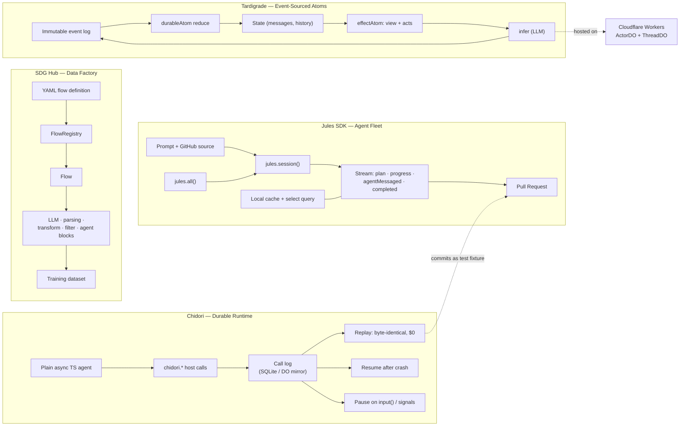
Data-Flow Comparison
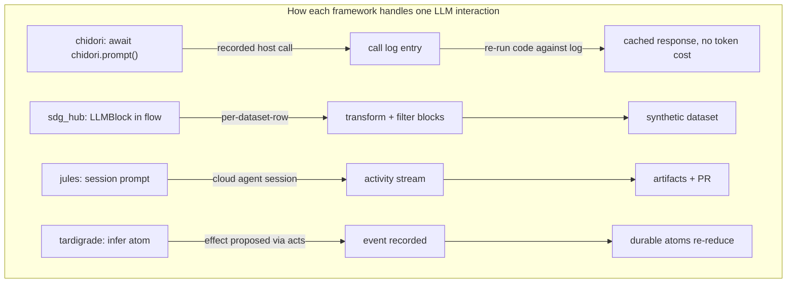
Positioning Map
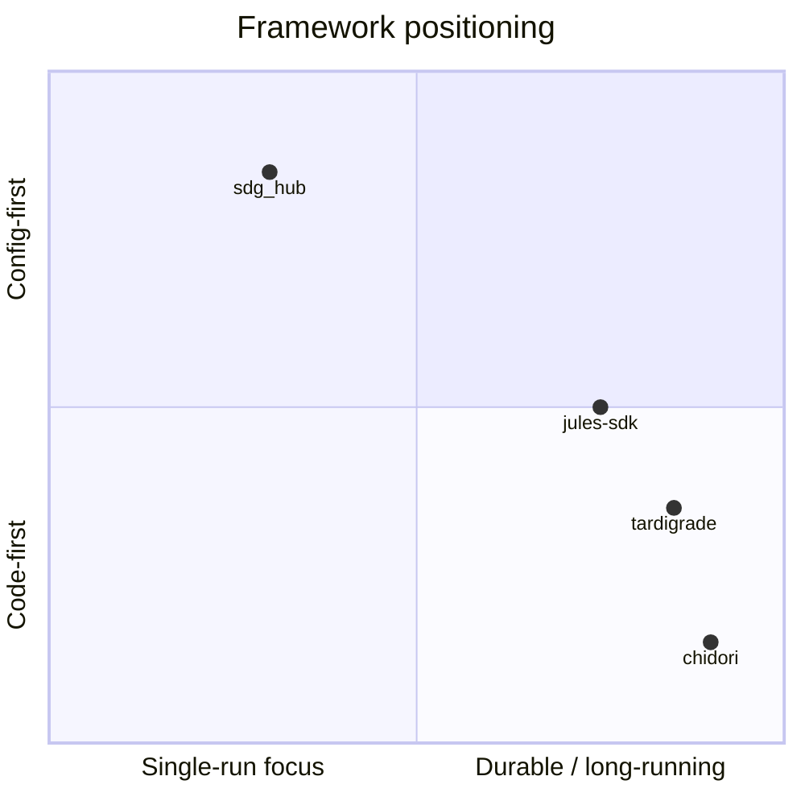
Common Pattern: Context / Memory Management
	Mechanism	Trigger	Cost on replay
chidori	Call log + prompt cache	Auto at host call	$0, byte-identical
tardigrade	compact effect atom	triggerRatio threshold	Re-reduce from event log (no LLM)
jules-sdk	Local SQLite cache + select	Every activity	n/a (cache read)
sdg_hub	Flow config per run	Explicit (YAML)	Full re-run


Deployment Targets
	Cloudflare	Self-hosted	Fleet/Cluster
chidori	DO mirror	plain VM / Fly / K8s	—
tardigrade	ActorDO + ThreadDO	Bun process	Celld fleet
jules-sdk	—	local CLI	Google-managed cloud
sdg_hub	—	Python process	—


Key takeaway: chidori and tardigrade are the two closest in spirit (durable TS agents), but take opposite approaches — chidori intercepts every side effect from outside (host-call boundary), while tardigrade makes state emerge from inside via event-sourced atoms. jules-sdk is the orchestration layer on top, and sdg_hub is the only config-first pipeline (YAML flows vs. code-first agents).


3:47


https://github.com/sjoerd2025/chidore https://github.com/sjoerd2025/sdg_hub


3:47


Fetching chidore to check if it's a separate repo (vs. chidori):


Used GitHub integration


 chidore (with an "e") 404s — the actual repo is sjoerd2025/chidori (no "e"), which I've already fetched and profiled above. sdg_hub is confirmed at sjoerd2025/sdg_hub (Red Hat AI Innovation Team's synthetic data generation framework).
So the consolidated picture stands as-is — all four repos live under sjoerd2025:
- chidori — durable/replayable TS agents on a Rust runtime
- sdg_hub — YAML-flow synthetic data generation in Python
- jules-sdk — TS orchestration of cloud coding agents
- tardigrade — event-sourced atom-based TS agents on Cloudflare DOs
Want me to do anything further with these — e.g. cross-referencing their APIs, a deeper dive into one repo's docs, or setting up a comparison scaffold in your workspace?


3:48


ok add https://github.com/sjoerd2025/multica on top


3:49


Fetched file


Multica added — here's the updated consolidated view with it on top:
Overview
Repo	Language	License	Core Concept
multica	Go + Next.js/Electron/Expo	Multica License (Apache-2.0 + conditions)	Agent workspace — assign work to AI coding agents like teammates on a board
chidori	TS agents on Rust runtime	Apache-2.0	Durable, replayable agents — every side effect is a recorded host call
sdg_hub	Python	Apache-2.0	YAML-defined synthetic data generation flows from composable blocks
jules-sdk	TypeScript	Apache-2.0	Orchestrate fleets of cloud coding agents against GitHub repos
tardigrade	TypeScript (Effect TS)	Apache-2.0	Composable agents on an immutable event log — atoms all the way down


Architecture Diagram
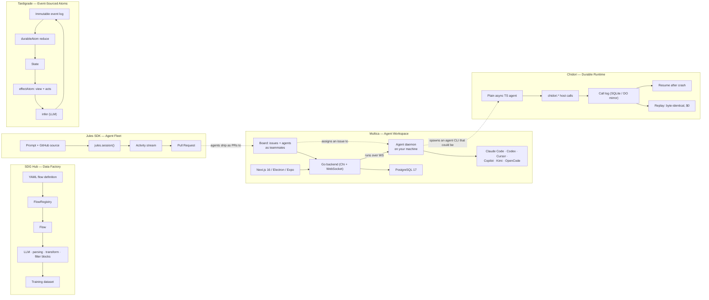
Positioning Map
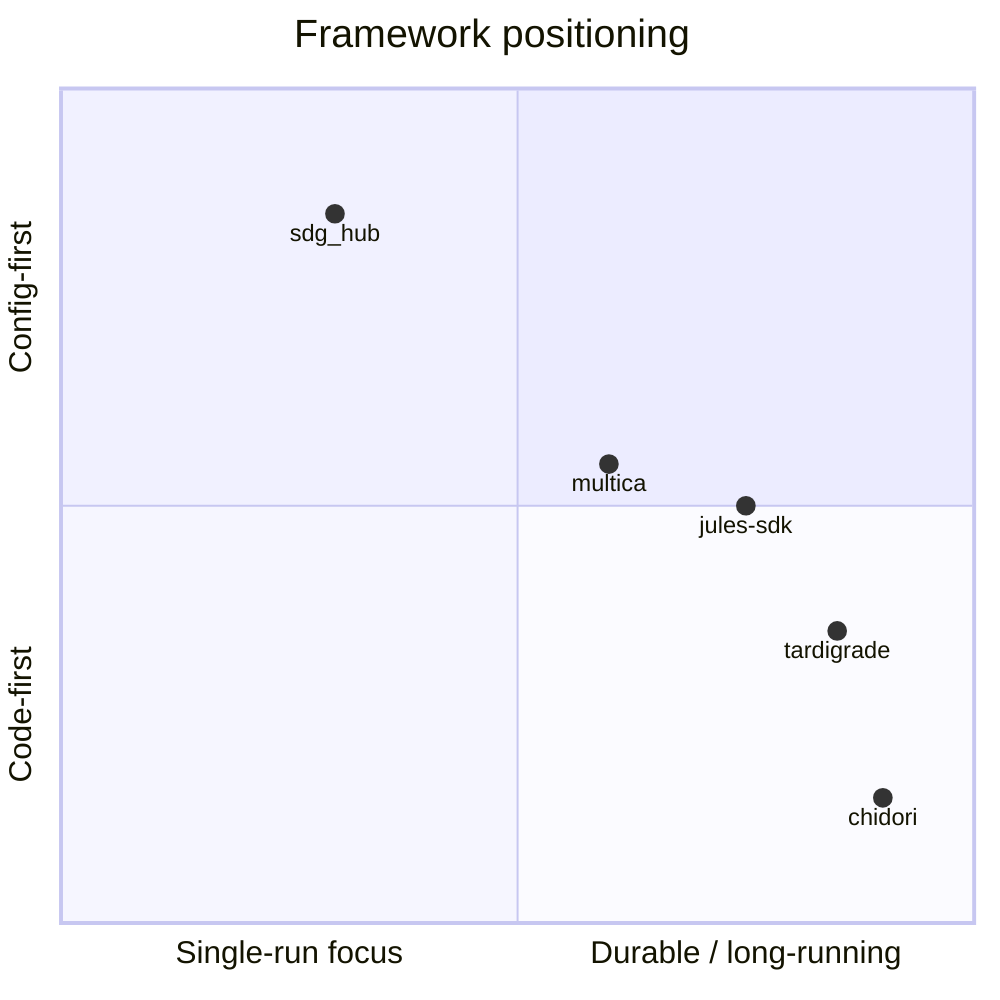
How They Connect
- Multica sits at the top — it's the human-facing workspace where you assign work; the other four are what runs underneath when an agent picks up that work.
- Multica → jules-sdk: both are "drive coding agents" layers, but Multica is self-hosted/local-daemon based while jules is Google-cloud managed. Either could back Multica's daemon.
- chidori / tardigrade are the two durable-runtime candidates for agents that need to survive crashes and pause for human approval — directly complementary to Multica's "review gates" and "inbox" model.
- sdg_hub is orthogonal — it generates training data (e.g., for fine-tuning the agents Multica orchestrates), not run them.
Key takeaway: Multica is the orchestration surface (issues, board, review gates), while chidori/tardigrade provide the durable runtime layer, jules-sdk the managed cloud fleet, and sdg_hub the training-data factory.


3:50


cant you reverse engineer the sgd_hub with the setup of blocks and flows into chidori / tardigrade or is langflow than better


3:57


 Interesting question — the answer is yes in a narrow sense, but with a big caveat. Let me reason through it carefully:
Can you express sdg_hub's blocks/flows in chidori or tardigrade? Yes, mechanically:
- sdg_hub's Flow.from_yaml → a defineActor in tardigrade, or a plain async TS function in chidori.
- Each block (LLM block, transform block, filter block) → either a chidori.* host call (chidori.prompt, chidori.memory for caching) or a tardigrade effectAtom.
- The dataset row iteration → chidori's replay/checkpoint gives you per-row resume for free — this is actually better than sdg_hub's YAML flow, which re-runs the whole flow on failure.
But sdg_hub isn't really the right comparison point — it's a data-factory tool, not an agent runtime. The real question is whether the abstraction (config-first YAML flows) or the abstraction (code-first agents) wins for synthetic data generation. That's a tradeoff:
	sdg_hub (YAML flow)	chidori/tardigrade (code-first)
Non-technical authors	✅ better — no code	❌ worse
Resume after crash	⚠️ re-run whole flow	✅ per-row checkpoint, $0 replay
LLM cost on re-run	full re-bill	~$0 (call log replay)
Flexibility (loops, branching, custom logic)	limited (YAML schema)	✅ full TS/Go control flow
Reuse as component	needs custom block	it's just a function


Is langflow better? Different niche entirely — langflow is a visual drag-and-drop UI for building LLM pipelines. It's config-first like sdg_hub but with a graphical editor. Compared to sdg_hub: langflow wins on visual authoring, sdg_hub wins on version-control (YAML in git, diffable, reviewable) and programmatic reuse. Compared to chidori/tardigrade: langflow is not durable, not replayable, and not code-first, so it's not a real competitor to those.
My honest take:
- If your goal is generating training data and you have non-technical team members who need to edit flows → keep sdg_hub (or langflow if they want a GUI).
- If your goal is building agents and you want the data-gen step to be part of the agent's durable run (checkpointed, resumable, replayable) → re-express sdg_hub's blocks/flows as chidori host calls or tardigrade effectAtoms. This is strictly better for programmatic/reproducible use — per-row resume, $0 replay, and the flow becomes a reusable function instead of a YAML file.
- Don't use langflow for anything that needs to be version-controlled or run headless — it's a visual prototyping tool, not a runtime.
So: reverse-engineer it if you want data-gen embedded in durable agent runs; keep sdg_hub if YAML flows for non-technical authors is the point. Langflow is neither better nor worse — it's a different axis (GUI authoring vs. code/YAML authoring).


3:58


langchain and langgraph


4:00


 Good addition — LangChain and LangGraph are the two biggest players in this space, so they deserve a proper slot in the map. Key distinction: LangChain ≠ LangGraph — they solve different problems.
What each is
- LangChain — the original LLM utility library: prompt templates, output parsers, retrieval (RAG), document loaders, vector store integrations, tool bindings. It's plumbing, not orchestration.
- LangGraph — the actual agent runtime: a stateful graph (nodes + edges) where the LLM decides which node to call next. Adds checkpointing, human-in-the-loop interrupts, time-travel debugging, and streaming on top of that graph.
Most people conflate them; LangGraph is the modern layer, LangChain is the legacy/integration layer it builds on.
Where they fit in the map
	LangGraph	chidori	tardigrade	multica	sdg_hub	langflow
Abstraction	Graph of nodes	Plain TS code	Event-sourced atoms	Issues + board	YAML flows	Visual canvas
Authoring	Python/TS code	TS code	TS code (Effect)	Issue text	YAML	Drag-and-drop GUI
Durability	Checkpoints (SQLite/Postgres)	✅ every host call	✅ event log	execution log	❌	❌
Replay	Time-travel (re-derive from checkpoint)	✅ byte-identical, $0	⚠️ re-reduce	✅ tool-call log	❌	❌
Human-in-loop	✅ interrupt()	✅ input()/signals	✅ effectAtom pause	✅ review gates	❌	❌
Ecosystem	Massive (LangChain, LangSmith, Langfuse)	Small but focused	Small, niche	Growing	Red Hat backed	Large community


Key differences vs. your stack
LangGraph vs. chidori — closest rivals, different bet:
- LangGraph records state at checkpoints (the graph's variables). Replaying means re-executing nodes from a snapshot.
- Chidori records every side effect. Replaying means re-running code against the log — no snapshot needed, and the output is byte-identical by construction. LangGraph's checkpoint snapshot approach is more forgiving if your code changed between runs (it just loads the state); chidori's is more strict but gives you free deterministic test fixtures.
LangGraph vs. tardigrade — both event-driven, different granularity:
- Tardigrade reduces an immutable event log into atoms; the graph emerges from data dependencies, not an explicit graph definition.
- LangGraph requires you to declare nodes and edges up front; the state machine is visible but also more boilerplate. Tardigrade is more "reactive programming", LangGraph is more "explicit state machine".
LangGraph vs. multica — different layer entirely:
- Multica is above LangGraph — it's where humans assign work to agents (and those agents could internally be LangGraph graphs, chidori runs, or plain Claude Code sessions). Multica doesn't care what runtime the agent uses.
LangGraph vs. sdg_hub — same config-first problem, different solution:
- sdg_hub chose YAML flows; LangGraph chose Python code that looks like a graph. Both are "configurable pipelines for LLM work", but LangGraph's approach is more powerful (loops, branching, state) while sdg_hub's is more accessible to non-coders.
Updated positioning map
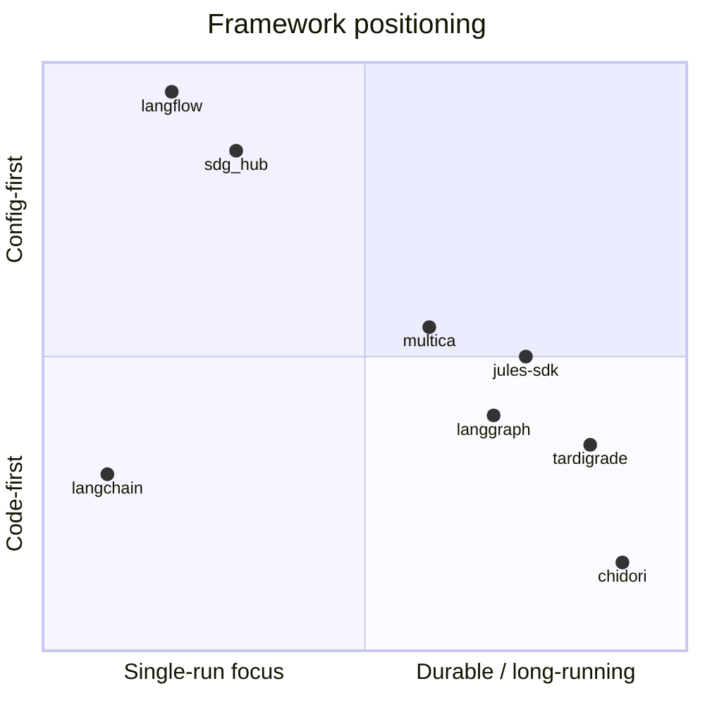
My take on the whole field now
- LangChain is the safest default — huge ecosystem, works everywhere — but it's plumbing, not a runtime. You'd pair it with LangGraph.
- LangGraph is the industry default for durable agents. If you don't have a strong opinion, it's the pragmatic choice. Its checkpoint/replay model is good but not as strict as chidori's.
- chidori / tardigrade are the two interesting challengers — chidori's "record every side effect" is architecturally cleaner (byte-identical replay as a feature), and tardigrade's event-sourced atoms are more composable than LangGraph's explicit graphs. Both are bet-worthy if you want to avoid LangChain ecosystem lock-in.
- multica / jules-sdk sit above the runtime choice — they orchestrate whatever agent you pick.
- sdg_hub / langflow are the config-first/GUI tier — fine for data-gen or prototyping, not for production durable agents.
Want me to go deeper on any pairing — e.g. a side-by-side code comparison of LangGraph vs. chidori for the same agent task, or a LangGraph → tardigrade migration sketch?


could you vizualize how to setup the best workflows in github and linear to dispatch work to actors and agents on cloudflare witg chidori and tardigrade


4:09


with multica on top


 Here's the full visualization — mapping multica's domain model (the entities from your image: Project, User, Member, Agent, Task, Skills, Tool, Toolkit) onto a GitHub + Linear dispatch flow with chidori and tardigrade runtimes on Cloudflare.
Layer 1 — The Big Picture
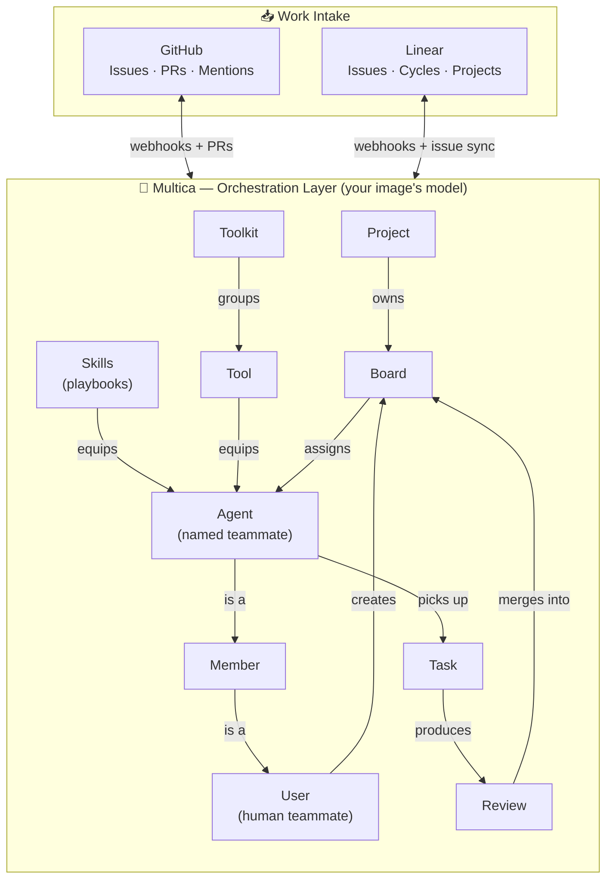
Layer 2 — Dispatch Flow (GitHub & Linear → Runtime)
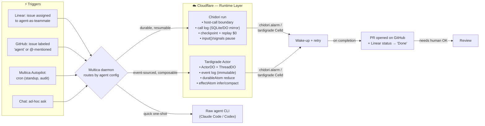
Layer 3 — Sequence (one task, end to end)
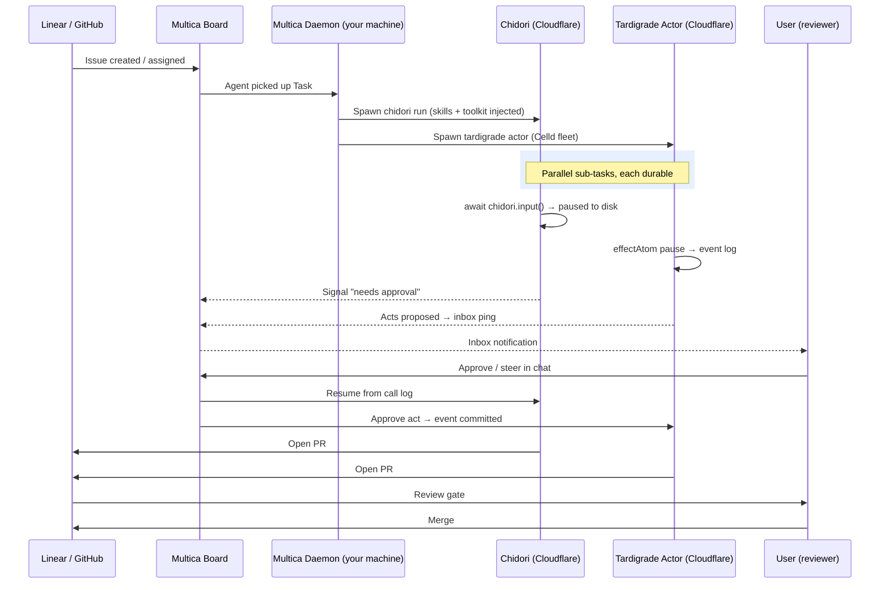
Layer 4 — Which Runtime for Which Work
Work type	Runtime	Why
Multi-step, expensive, human-gated	Chidori	$0 replay, checkpoint-as-test, signals for approval
Reactive / always-on / webhook-driven	Tardigrade	ActorDO survives hibernation, event-sourced state, composable atoms
One-shot code change	Raw CLI via daemon	Fastest path, no durability needed
Scheduled standup/audit	Chidori (alarm)	Deterministic replay of last run as baseline
Long-lived chat agent	Tardigrade ThreadDO	Message history in event log, survives hibernation


Layer 5 — The Setup Checklist
GitHub side:
- Connect repo in Multica → webhook installed automatically
- Label agent:chidori / agent:tardigrade on issues → daemon routes accordingly
- PRs come back as normal — review gate is just Multica's Review entity
Linear side:
- Connect workspace → issues sync bidirectionally
- Create agents as teammates (multica Agent entity) with a Squad
- Assign issues to agent-teammates → daemon picks up
- Autopilot cron → recurring audits/standups without a human reminding
Multica side:
- Skills = reusable playbooks (e.g., "reproduce bug → fix → PR") — saved once, equipped to every agent
- Toolkit = the Tool set each agent can call (both chidori's chidori.* and tardigrade's acts surface appear here as tools)
Cloudflare side:
- Chidori binary deployed with --durable-object mirror for durability beyond local disk
- Tardigrade ActorDO + ThreadDO deployed to your CF account; Celld for the fleet
- Both keyed to the same Multica daemon for status callbacks

## System Architecture and Multi-Runtime Topology

### Framework Positioning Matrix

| Quadrant | Frameworks | Focus and Characteristics |
| :--- | :--- | :--- |
| **Config-first / Single-run** | Langflow, SDG Hub | Declarative flows, data factory pipelines, single-pass generation. |
| **Config-first / Durable** | Multica, Jules SDK | Board orchestration, team entity modeling, issue-driven session loops. |
| **Code-first / Single-run** | LangChain | Programmatic LLM chaining without built-in process durability. |
| **Code-first / Durable** | LangGraph, Tardigrade, Chidori | Event-sourced state machines (Tardigrade), checkpoint/replay execution (Chidori). |

### 1. Orchestration Domain Model

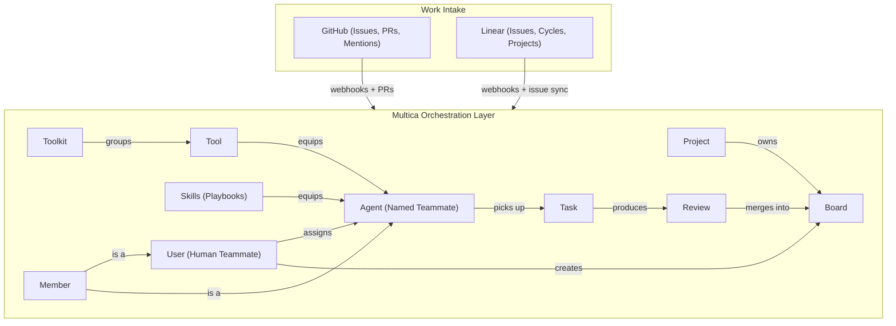

### 2. Multi-Runtime Intake and Daemon Routing

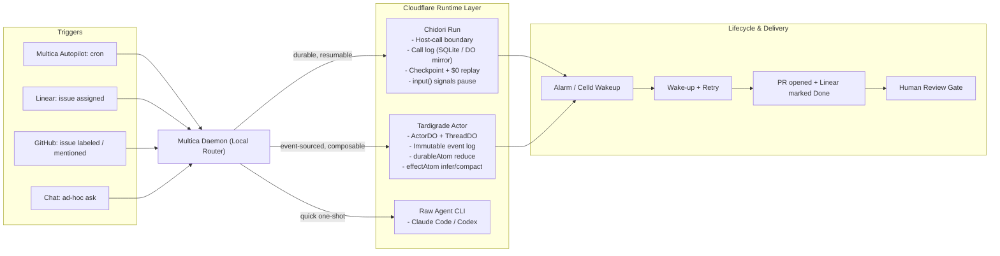

### 3. Execution Sequence and Human Gate

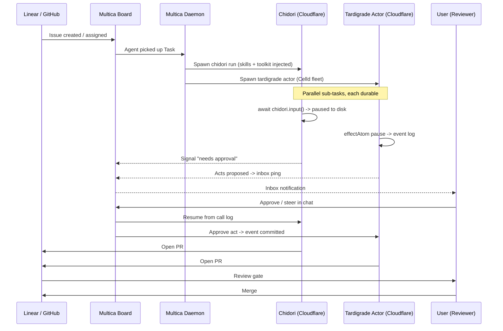

### 4. End-to-End System Integration Topology

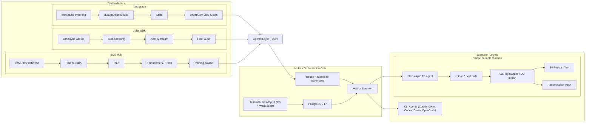
